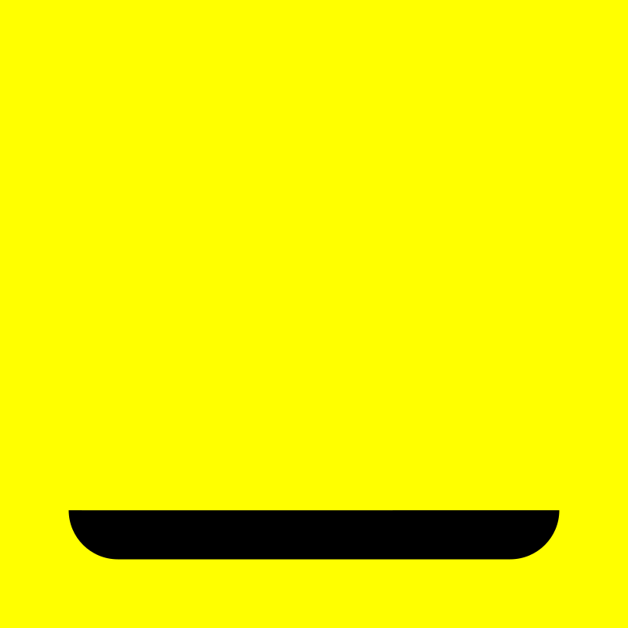

_This project has been created as part of the 42 curriculum by [iscarval](https://github.com/Isabelle-AL) and [ferde-so](https://github.com/ferdesmello)._

# A-Maze-ing
Create your own maze generator and display its result!

## Description 
clearly presents the project, including its goal and a
brief overview.

## Instructions 
any relevant information about compilation,
installation, and/or execution.

### Virtual environment

Create one following:

```bash
python3 -m venv .venv
source .venv/bin/activate
```

```bash
deactivate
```

### Running

```bash
python3 a_maze_ing.py config.txt
```

## Resources 

classic references related to the topic (documentation, articles, tutorials, etc.), as well as a description of how AI was used — specifying for which tasks and which parts of the project.

https://en.wikipedia.org/wiki/Maze_generation_algorithm
https://en.wikipedia.org/wiki/Maze-solving_algorithm


## Additional sections

### The complete structure and format of your config file.

The config file has six obligatory and one optional parameters.

* WIDTH — single integer for the number or columns of the maze.
* HEIGHT — single integer for the number or rows of the maze.
* ENTRY — (x, y) integer coordinates of the maze entrance point.
* EXIT — (x, y) integer coordinates of the maze exit point.
* OUTPUT_FILE — string for the output maze file.
* PERFECT — boolean flag for a perfect (or not) maze.
* SEED — optional integer for the seed to use in the random creation process.

Example of the content of the configuration file `config.txt`

```text
WIDTH=20
HEIGHT=15
ENTRY=0,0
EXIT=19, 14 
OUTPUT_FILE=output_maze.txt
PERFECT=False
SEED=50
```

### The maze generation algorithm you chose.


### Why you chose this algorithm.


### What part of your code is reusable, and how.


### Your team and project management with:


### The roles of each team member.


### Your anticipated planning and how it evolved until the end


### What worked well and what could be improved


### Have you used any specific tools? Which ones?

## Advanced features
(multiple algorithms, display options...)


Hexadecimal values for the walls
| binary | decimal | hexdecimal | wall | figure |
|---|---|---|---|---|
| 0b0000 | 0 | 0x0 | **None** |  |
| 0b0001 | 1 | 0x1 | **NORTH** |  |
| 0b0010 | 2 | 0x2 | **EAST** |  |
| 0b0011 | 3 | 0x3 | N, E |  |
| 0b0100 | 4 | 0x4 | **SOUTH** |  |
| 0b0101 | 5 | 0x5 | N, S |  |
| 0b0110 | 6 | 0x6 | E, S |  |
| 0b0111 | 7 | 0x7 | N, E, S |  |
| 0b1000 | 8 | 0x8 | **WEST** |  |
| 0b1001 | 9 | 0x9 | N, W |  |
| 0b1010 | 10 | 0xa | E, W |  |
| 0b1011 | 11 | 0xb | N, E, W |  |
| 0b1100 | 12 | 0xc | S, W |  |
| 0b1101 | 13 | 0xd | N, S, W |  |
| 0b1110 | 14 | 0xe | E, S, W |  |
| 0b1111 | 15 | 0xf | **All** |  |
