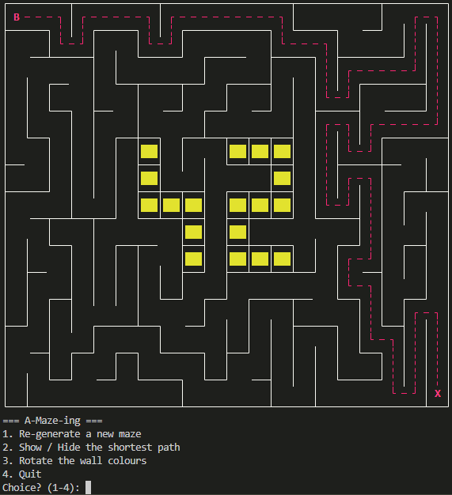
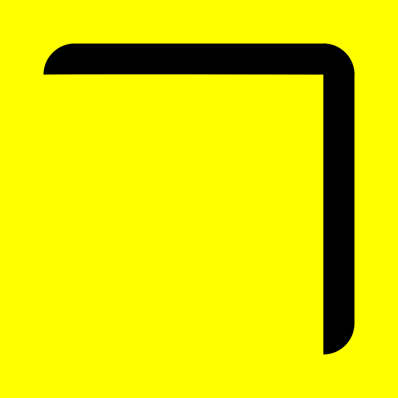
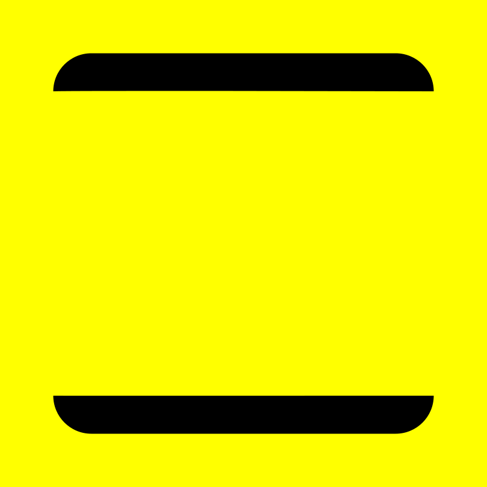

_This project has been created as part of the 42 curriculum by [iscarval](https://github.com/Isabelle-AL), [ferde-so](https://github.com/ferdesmello)._

# A-Maze-ing

Create your own maze generator and display its result!

Example of the terminal output and interface:



## Description

This project generates a maze from a configuration file, displays it in the
terminal, finds a shortest path from the entry to the exit, and saves the
generated maze and path to the configured output file.

The maze can be perfect (without loops) or non-perfect (with loops and fewer
dead ends). Mazes large enough for it also contain a blocked 42 logo area.

* The minimum is width 9 and height 7

## Instructions

The project requires Python 3 and uses the Python standard library at runtime.
Optional development dependencies are listed in `requirements.txt`.

### Virtual environment

Create one following:

```bash
make install
source venv/bin/activate
```

```bash
deactivate
```

### Running

Run with the sample configuration:

```bash
python3 a_maze_ing.py config.txt
```

The configuration filename can also be omitted, in which case `config.txt` is
used:

```bash
python3 a_maze_ing.py
```

The interactive menu can generate another maze, show or hide its shortest
path, rotate wall colours, or quit. The generated maze is written to the
`OUTPUT_FILE` specified in the configuration.

The Makefile also provides:

```bash
make run
make debug
make lint
make lint-strict
make clean
```

## Resources

The following references cover the project topic and terminal rendering:

- The 42 school project specifications

https://en.wikipedia.org/wiki/Maze_generation_algorithm

https://en.wikipedia.org/wiki/Maze-solving_algorithm

https://en.wikipedia.org/wiki/Box_Drawing

https://en.wikipedia.org/wiki/ANSI_escape_code

https://gist.github.com/JBlond/2fea43a3049b38287e5e9cefc87b2124

## AI-use description:


## Additional sections

### The complete structure and format of your config file.

The configuration file contains six required parameters and one optional
parameter. Blank lines and lines beginning with `#` are ignored.

* `WIDTH` — integer from 1 to 100 for the number of columns.
* `HEIGHT` — integer from 1 to 100 for the number of rows.
* `ENTRY` — integer coordinates in the form `x,y` for the maze entrance.
* `EXIT` — integer coordinates in the form `x,y` for the maze exit.
* `OUTPUT_FILE` — path of the output maze file.
* `PERFECT` — either `True` or `False`.
* `SEED` — optional integer from 0 to 10000 for reproducible generation.

The entry and exit must be different and inside the maze. `ENTRY` and `EXIT`
must not overlap the blocked 42 logo when that logo is present.

* unknown config keys are rejected

* PERFECT is case-sensitive (True or False).

Example of the content of the configuration file `config.txt`

```text
WIDTH=20
HEIGHT=15
ENTRY=0,0
EXIT=19,14 
OUTPUT_FILE=output_maze.txt
PERFECT=False
SEED=42
```

The output file contains one hexadecimal character per maze cell, one row per
line. After a blank line, it contains the entry coordinates, exit coordinates,
and shortest path as a sequence of `N`, `E`, `S`, and `W` directions.

### The maze generation algorithm you chose.
The generator first creates a grid with all four walls closed. It then uses a
randomized depth-first search (recursive backtracking implemented with an
explicit stack) to open passages and visit every available cell.

When `PERFECT=False`, the generator removes selected dead ends and opens
additional passages while avoiding fully open 3-by-3 areas. It ensures that
the resulting maze has at least two independent loops.

### Why you chose this algorithm.

* It’s simple to explain, since it’s a stack-based DFS.

* It always produces a spanning tree, which is exactly a perfect maze.

* Dead-end removal is a separate step layered on top, which gives you the non-perfect mode.

### What part of your code is reusable, and how.

`MazeGenerator` in `mazegen.py` is a standalone class that only uses the
Python standard library. It is packaged as `mazegen-1.0.0-py3-none-any.whl`
(and `.tar.gz`) at the root of the repository. Only `mazegen.py` is in the
package; `display.py` and `validate.py` are not.

Install and build:

```bash
pip install mazegen-1.0.0-py3-none-any.whl
# rebuild from sources:
pip install build && python3 -m build
```

Basic example:

```python
from mazegen import MazeGenerator

generator = MazeGenerator(
    width=20, height=15,
    entry=(0, 0), exit=(19, 14),
    perfect=False,   # True for a maze with no loops
    seed=42,         # same seed, same sequence of mazes
)
generator.generate()

grid = generator.grid      # grid[y][x]: int, bit 0=N, 1=E, 2=S, 3=W (1 = wall)
path = generator.solve()   # shortest path, e.g. ["S", "S", "E", ...]
```

Useful members: `blocked_cells` (cells of the 42 pattern, empty when the
maze is too small), `count_loops()`, `count_dead_ends()`, `is_consistent()`.
Invalid parameters raise `ValueError`.

### Your team and project management with:


### The roles of each team member.


### Your anticipated planning and how it evolved until the end


### What worked well and what could be improved


### Have you used any specific tools? Which ones?

The project uses Python 3, the standard-library `random` and `collections`
modules, and the built-in `pdb` debugger. `flake8` and `mypy` are listed as
development dependencies and are run by the Makefile lint targets.

## Advanced features

The project includes:

* Perfect and non-perfect maze generation.
* Reproducible generation with an optional seed.
* Shortest-path solving with breadth-first search.
* Terminal rendering with Unicode box-drawing characters.
* Optional shortest-path display.
* Rotating wall colours.
* A blocked 42 logo area for sufficiently large mazes.
* A hexadecimal representation of each cell's closed walls.

Hexadecimal values for the walls
| binary | decimal | hexdecimal | closed wall | figure |
|---|---|---|---|---|
| 0b0000 | 0 | 0x0 | **None** |  |
| 0b0001 | 1 | 0x1 | **NORTH** |  |
| 0b0010 | 2 | 0x2 | **EAST** |  |
| 0b0011 | 3 | 0x3 | N, E |  |
| 0b0100 | 4 | 0x4 | **SOUTH** |  |
| 0b0101 | 5 | 0x5 | N, S |  |
| 0b0110 | 6 | 0x6 | E, S |  |
| 0b0111 | 7 | 0x7 | N, E, S |  |
| 0b1000 | 8 | 0x8 | **WEST** |  |
| 0b1001 | 9 | 0x9 | N, W |  |
| 0b1010 | 10 | 0xa | E, W |  |
| 0b1011 | 11 | 0xb | N, E, W |  |
| 0b1100 | 12 | 0xc | S, W |  |
| 0b1101 | 13 | 0xd | N, S, W |  |
| 0b1110 | 14 | 0xe | E, S, W |  |
| 0b1111 | 15 | 0xf | **All** |  |
